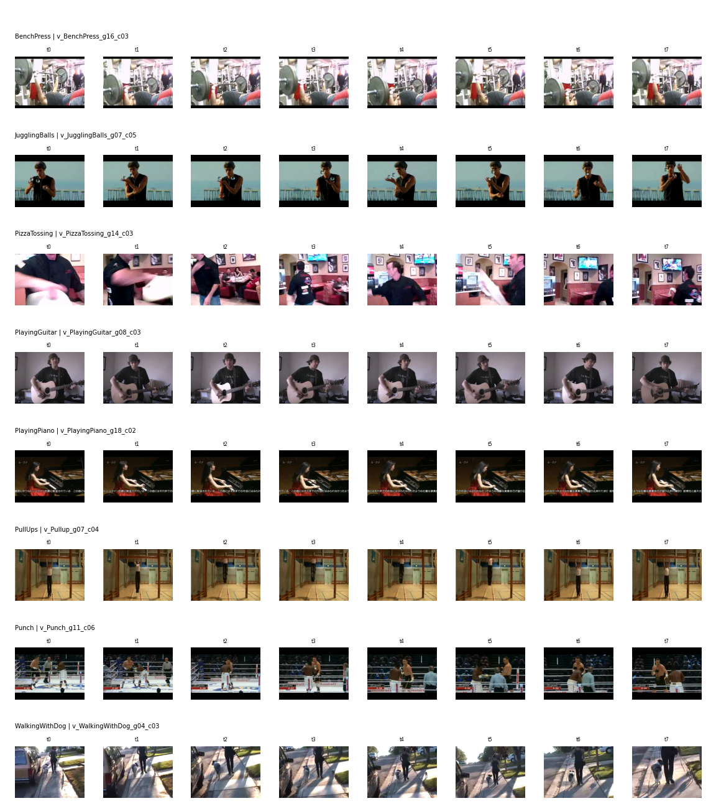
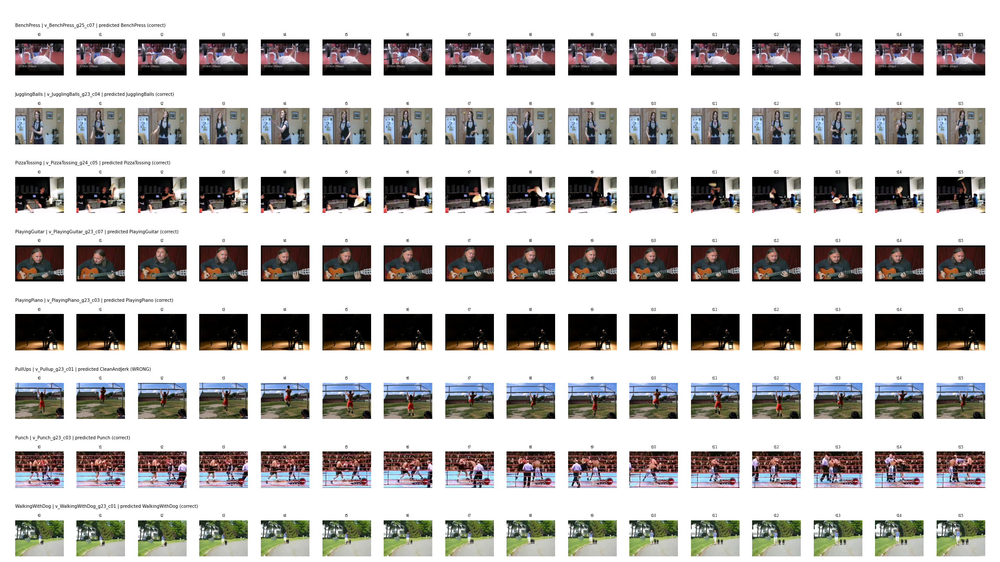

# Assignment 4: LRCN video action recognition on UCF50

EN.705.643, Assignment 4, David Carrillo.

This repository is the fixed and extended version of an LRCN (ResNet backbone, LSTM over time, linear classifier) codebase received for UCF50. The received code looked complete, but on current PyTorch it crashed before the first epoch, and once running it leaked test videos into training, fed the LSTM the wrong axis, shuffled frame order, and had more than a dozen further defects. After fixing those, a two-stream model that fuses an RGB LRCN with an optical-flow LRCN reaches 93.26% accuracy on held-out UCF50 groups (982 of 1,053 test clips; 980 are needed for 93%).

| Model | Val acc (802 clips) | Test acc (1,053 clips) |
| --- | --- | --- |
| Baseline: received code with the bugs fixed, original settings | 83.04% | 84.05% |
| Improvement 1: all frames through the backbone in one call | 87.41% | 85.75% |
| Flow stream alone (input to improvement 2) | 89.90% | 88.32% |
| Improvement 2: RGB (improvement 1) + flow, late fusion | 94.26% | **93.26%** |

All runs were logged to Weights & Biases, and screenshots of the dashboard are submitted with the assignment.

## Repository layout

```
src/ucf50_lrcn/     the package
    preprocess.py   videos -> 32 evenly spaced JPEG frames per video
    flow.py         videos -> 32 stacks of Farneback optical flow per video
    video_datasets.py, utils.py   dataset, group split, transforms, loaders
    models.py       LRCN (RGB or flow input)
    train.py, evaluate.py, run.py   training loop, evaluation, CLI
    fuse.py         late fusion of an RGB and a flow model
    visualize.py    clip grids, optionally with a model's predictions
scripts/            preprocess.sh, flow.sh, train.sh, test.sh, fuse.sh
tests/              pytest regression tests for the bugs fixed, plus a few shape checks
docs/figures/       figures used below
```

## Setup and data

Python 3.10 or newer; tested with PyTorch 2.14 and torchvision 0.29. Install the dependencies with `pip install -r requirements.txt` (plus `pytest` and `pylint` for the checks), and run the scripts with that environment active, since they call `python`. UCF50 is the 3.2 GB `UCF50.rar` from https://www.crcv.ucf.edu/data/UCF50.rar; extract it so that `data/UCF50/<Class>/<video>.avi` exists. Frames, flow and checkpoints are written under `data/` and `runs/`, both ignored by git.

## Reproducing the results

```bash
scripts/preprocess.sh                       # data/UCF50_frames: 32 frames per video
scripts/flow.sh                             # data/UCF50_flow: 32 flow stacks per video
NUM_WORKERS=12 scripts/train.sh --wandb_project <project> --wandb_run_name rgb
NUM_WORKERS=12 OUT_DIR=runs/flow scripts/train.sh --modality flow \
    --frame_dir data/UCF50_flow --wandb_project <project> --wandb_run_name flow
scripts/fuse.sh --wandb_project <project> --wandb_run_name fuse   # the 93.26% number
scripts/test.sh                             # re-evaluate the RGB checkpoint alone
```

Every run goes through `scripts/train.sh` and changes only the option it is testing. The shared settings are ResNet-34 pretrained on ImageNet-1k classification (the only pretraining, as the Module 7 lecture allows), 16 frames per clip, LSTM hidden size 100, batch size 4, Adam at 3e-5, ReduceLROnPlateau on validation loss, 30 epochs, and the epoch with the best validation accuracy kept. Weights & Biases logging is off unless `--wandb_project` is given.

Run the checks with `pytest` (23 tests, 24 cases) and `pylint src tests` (10.00/10).

## Environment

Training and evaluation: Python 3.12.3 on Linux, PyTorch 2.14.0a0+4fdf77b940.nv26.08, TorchVision 0.29.0a0, OpenCV 5.0.0, W&B 0.28.2. Device: one NVIDIA RTX 5090, without mixed precision. No seed is fixed, so retraining gives somewhat different numbers.

## Errors found and fixed

Each fix is its own commit, named after the bug. Where a bug could be pinned down by a test, the test is listed next to it; the tests are regression tests for these bugs, not a coverage suite.

| Problem in the received code | Effect | Regression test |
| --- | --- | --- |
| Train, val and test were drawn by `StratifiedShuffleSplit` over clips. UCF50 clips in the same group share actor, background and viewpoint. | Data leak: run on these frames, the received split put 997 of 1,003 test clips (99.4%) next to a clip of the same class and group in training. The split is now by group (val 19-21, test 22-25, train the rest, including the groups above 25 that six of the 50 classes have, up to group 30, despite the dataset's description of 25 groups), so no group spans two splits. | `test_no_group_appears_in_more_than_one_split` |
| The LSTM was built without `batch_first=True` and fed `(batch, 1, features)`. | It ran along the batch dimension, so each prediction depended on the other videos in the batch. | `test_prediction_does_not_depend_on_other_videos_in_the_batch` |
| Frames were saved without zero padding (`frame0.jpg`, `frame1.jpg`, ..., `frame10.jpg`) and loaded with an unsorted `glob`. | Clips reached the model out of temporal order (sorted names give 0, 1, 10, 11, ..., and `glob` gives arbitrary order). | `test_stored_frames_sort_in_temporal_order`, `test_dataset_loads_frames_in_temporal_order` |
| The loader kept the first `fr_per_vid` stored frames. | With 16 of 32 stored frames, every clip ended halfway through its video. Frames are now sampled evenly across the whole clip. | `test_dataset_samples_frames_across_the_whole_clip` |
| Extraction sampled `n_frames + 1` indices. | 33 frames were written where 32 were asked for. | `test_get_frames_returns_exactly_the_number_requested` |
| Extraction trusted the container's frame count. | Some UCF50 headers overstate it, so the last indices pointed past the end and 229 of 6,681 videos came out short. Decodable frames are now counted first. | `test_get_frames_ignores_an_overstated_header_frame_count` |
| Augmentation was applied frame by frame. | Each frame of a clip got its own random flip and shift, so the frames of one clip no longer lined up, which destroys the motion the LSTM models. The clip is now transformed once. | `test_training_augmentation_is_the_same_for_every_frame_of_a_clip` |
| `--cnn_backbone resnet152` built a ResNet-34. | The option silently trained the wrong model. | `test_resnet152_backbone_is_a_resnet152` |
| `--pretrained` was read as a string. | `--pretrained False` still loaded ImageNet weights, because any non-empty string is true. | `test_pretrained_flag_is_parsed_as_a_boolean` |
| `ReduceLROnPlateau(..., verbose=1)`. | Raises `TypeError` on current PyTorch, which removed the argument. | `test_training_setup_builds_on_current_pytorch` |
| The 3D-CNN collate filtered empty clips before pairing labels with them. | Every label after an empty clip shifted onto the wrong video. | `test_3d_collate_keeps_each_label_with_its_own_clip` |
| A `3dcnn` model type was accepted but never implemented. | Selecting it crashed with a channel mismatch. Only `lrcn` is accepted now. | |
| `run_training.py` duplicated `run.py` with broken imports. | Importing it failed. Removed. | |
| The scripts targeted HMDB51 (51 classes, a hard-coded `/home/vince` checkpoint) and passed the clip-split ratios the leak fix removed. | The documented commands did not run on UCF50. | |
| Eval mode loaded checkpoints with plain `torch.load`. | A checkpoint trained on a GPU could not be evaluated on a machine without CUDA. | |
| Deprecated `pretrained=True` backbone loading. | Replaced by the torchvision weights API (`IMAGENET1K_V1`, the same weights). | |
| A clip shorter than `fr_per_vid` came back short, `collate_fn_rnn` padded it with zero frames at the end, and the classifier reads the LSTM's last step. | Such a clip was classified from padding. Short clips now repeat frames. No video has fewer than 16 frames, so this never fired in the reported runs. | `test_short_clip_still_yields_fr_per_vid_frames` |
| `load_dataset` listed every directory entry. | A macOS `.DS_Store` in the frame root would become class 0 and shift every label. Hidden entries and files are skipped. | `test_hidden_files_do_not_become_classes_or_videos` |
| Eval mode built the backbone with ImageNet weights before loading the checkpoint over them. | Evaluation needed network access to download weights it then discarded. | `test_eval_mode_does_not_fetch_imagenet_weights` |
| The best validation accuracy started at 0 and only a strictly better epoch was saved. | A run that never got a validation clip right wrote no checkpoint, so evaluation failed on a missing file. | `test_a_checkpoint_is_saved_even_if_validation_accuracy_stays_zero` |

Looking at the data going in was part of finding these. `python -m ucf50_lrcn.visualize --frame_dir data/UCF50_frames` draws one clip from each of several classes as the model receives it, frames left to right in sampled order:



## Model improvements

I made two changes to the model, kept the training settings fixed, and measured each against the fixed baseline on the same group split. The first makes batch normalisation (Module 2) work as intended inside the LRCN; the second is the two-stream architecture from Module 7 (slides 38-40).

### Improvement 1: run all frames through the backbone in one call (+1.71 test points)

The received `forward` looped over time and called the ResNet once per frame, each time on a batch of four images. Calling it once on all `batch * time` frames gives the same output in eval mode, up to float rounding, but in training mode the ResNet's batch normalisation layers now compute their statistics from all 64 frames of the four clips instead of from the four frames at one time step, which is a poor sample for those statistics. Best validation accuracy rose from 83.04% to 87.41%, validation loss at that epoch fell from 0.70 to 0.59, and test accuracy from 84.05% to 85.75%. The test gain is 18 clips, so I treat its size as approximate; the direction agrees on val loss, val accuracy and test accuracy.

### Improvement 2: a flow stream fused with the RGB stream (+7.50 test points)

Even after improvement 1, the RGB runs reached 99-100% training accuracy while validation stalled in the mid 80s, so the RGB models fit the training groups far better than unseen ones. The two-stream design (Simonyan and Zisserman, 2014) adds a second network that sees only motion. `flow.py` computes Farneback optical flow at 32 evenly spaced positions per video, five consecutive frame pairs each, and stores the horizontal and vertical components as ten channels, the stacked-flow input of the temporal stream. A second LRCN with the same ImageNet-pretrained ResNet-34 takes those ten channels; its first convolution starts from the pretrained RGB filters averaged over colour and copied to each channel, as Wang et al. (2016) do. Flow is normalised with its own statistics, measured on training videos, and horizontal flips also negate the x channels, since a mirrored video moves the other way; three tests in `test_flow.py` and `test_flow_flip.py` check the channel layout and the flip.

Alone, the flow stream reached 88.32% on test, better than any RGB model. Averaging its softmax with the RGB model's gives 93.26% on test and 94.26% on validation, 4.9 points above the flow stream and 7.5 above the RGB stream.

Two other changes made results worse: averaging every LSTM step's logits instead of classifying from the last step (82.34% test), and a ResNet-101 RGB stream (84.14% alone, 90.22% fused with flow). The ResNet-101 fusion was two clips better on validation (94.51% against 94.26%); I chose the ResNet-34 fusion after seeing both test numbers, treating a two-clip validation gap as noise and preferring the smaller model.

## Weights & Biases

Every training run logs train and val loss and accuracy per epoch (and train loss and accuracy per batch) to W&B, then the test loss and accuracy of its best checkpoint. The fusion runs log each stream's and the fused val and test accuracy (`test/acc_fused`). The runs appear in the screenshots under these names:

| W&B run | Configuration |
| --- | --- |
| `baseline` | baseline |
| `batched` | improvement 1 |
| `mean` | improvement 1 with every step's logits averaged |
| `flow` | flow stream |
| `r101` | ResNet-101 RGB stream |
| `fuse-batched-flow` | fusion, improvement 1 + flow (final) |
| `fuse-r101-flow` | fusion, ResNet-101 + flow |

Predictions of the final RGB stream on one test clip from each of eight classes, drawn with `visualize --split test --ckpt <rgb checkpoint>`; the RGB stream alone misses the pull-up, which it confuses with a clean and jerk:



Each configuration was trained once, and the final result clears 93% by two clips. Evaluation reproduces to about a clip rather than exactly: re-evaluating the improvement-1 checkpoint on a CPU with frames extracted by a different OpenCV version gave 85.66% instead of 85.75%.

## References

- Donahue, J., et al. (2015). Long-term recurrent convolutional networks for visual recognition and description. CVPR.
- Simonyan, K., and Zisserman, A. (2014). Two-stream convolutional networks for action recognition in videos. NeurIPS.
- Wang, L., et al. (2016). Temporal segment networks: Towards good practices for deep action recognition. ECCV.
- Farnebäck, G. (2003). Two-frame motion estimation based on polynomial expansion. SCIA.
- Reddy, K. K., and Shah, M. (2013). Recognizing 50 human action categories of web videos. Machine Vision and Applications (UCF50).
